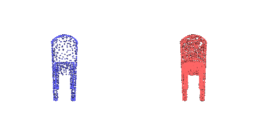
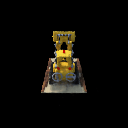
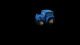
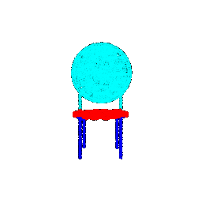

# Learning for 3D Vision

My coursework for **CMU 16-825 Learning for 3D Vision** (Fall 2026). There are five assignments, from differentiable rendering to neural fields, Gaussian splatting, multi-view transformers and point-cloud networks. Each assignment folder has the code I wrote and the report website with the results.

<p align="center">
  
  
  
  
  
</p>

## Assignments

| # | Topic | What I built | Highlights |
|---|---|---|---|
| [1](assignment1) | **Rendering Basics with PyTorch3D** | 360° mesh renders, dolly zoom, hand-built meshes (tetrahedron, cube, Menger sponge), retexturing, camera transforms, point clouds from RGB-D, parametric and implicit surfaces, area-weighted mesh sampling | Rendered GIFs for every part |
| [2](assignment2) | **Single-View to 3D** | Losses for fitting voxels, points and meshes directly. Image-to-3D decoders that predict a 32³ voxel grid, 1,000 points or a deformed sphere mesh. Implicit and parametric decoders as extensions | Voxel F1@0.05 = 65.88; points scored highest |
| [3](assignment3) | **Neural Volume Rendering and Surface Rendering** | Differentiable volume rendering, NeRF (with view dependence and coarse/fine sampling), VolSDF surfaces, 3D Gaussian rasterization and training, spherical harmonics, an L1 + SSIM loss | NeRF test PSNR 23.08 dB on held-out Lego views |
| [4](assignment4) | **Multi-View Transformers** | Multi-view data preprocessing (unprojection, camera canonicalization, Plücker rays). Mini-LVSM for novel-view synthesis. Mini-VGGT for camera and depth prediction on ScanNet++ | LVSM overfit 30.99 dB, val PSNR 12.2 → 16.13 dB, ray-conditioning ablations |
| [5](assignment5) | **Point Cloud Classification and Segmentation** | PointNet classification and part segmentation, robustness to point count and rotation, and DGCNN (EdgeConv) for locality | Cls 97.17% → **98.32%** with DGCNN; seg 87.65% → **90.2%** |

## Repository layout

```
assignmentN/
  code/       the source I submitted (models, training and evaluation scripts)
  website/    the report: open website/index.html in a browser
```

The datasets, checkpoints and training outputs are not included because they are large and can be regenerated. Setup and download steps are in each course handout, at [github.com/learning3d](https://github.com/learning3d). Assignments 3–5 also have a `code/README.md` with the exact commands I ran.

## Viewing the reports

Clone the repo and open any `assignmentN/website/index.html`. All image links are relative, so the reports work offline.

```bash
git clone https://github.com/farnazalamahmed99-cmu/Learning_for_3D_Vision.git
```

## Tech

Python · PyTorch · PyTorch3D · NumPy · Matplotlib · ImageIO. Trained on a local NVIDIA GPU and an AWS g5 instance (A10G).

## Other coursework

[`16_662_HW4`](16_662_HW4) is a homework from CMU 16-662: Q-learning agents and their visualizations.
